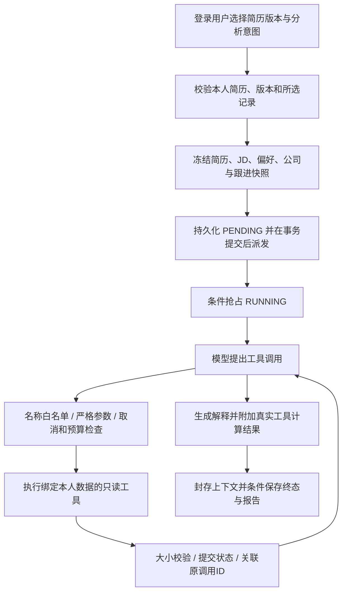

# 求职助手：运行、结构与边界

2026-10-28发布整合：基于GitHub最新主分支合入求职助手，沿用已移除照片抠图的处理；简历版本与纯文字PDF导出保留。照片服务和模型文件不进入本次发布。新版已部署，生产验证和回退信息见 [发布记录](RELEASE-20261028.md)；以下离线说明保留开发验证范围。

## 本地体验

项目目录为 `G:\I_dont_now`。双击根目录 `启动求职助手.cmd`，启动 Java 21 + Maven 的隔离离线预览；就绪后打开：

- 我的求职：<http://127.0.0.1:18080/job-assistant.html>
- 简历与版本：<http://127.0.0.1:18080/workspace.html>

此入口明确使用 Demo 和内存数据库，不读取根目录 `.env`，不调用付费模型或搜索。注册预览账号后，到版本工作台创建/导入简历，再进入“我的求职”。预览账号和数据会随预览进程重启清空。正常服务仍按 `backend/README.md` 使用原有 H2/MySQL 和模型配置；两个实例数据不互通。

推荐体验步骤：创建简历 → 保存定制版本 → 填偏好 → 收藏一份真实JD → 添加公司及来源 → 加入投递跟进 → 选择简历版本执行分析。没有岗位或公司资料也能执行概览；明确选择“岗位匹配”或“公司整理”但没有所需资料时，会要求先补充。Agent 分析只读；只有用户点击表单保存才写入求职记录。

## 模块与职责

| 模块 | 负责内容 |
|---|---|
| `career/CareerController` | HTTP适配，当前登录账号绑定 |
| `CareerService` / `CareerRepository` | 所有权、输入和数量约束、数据库写入及乐观并发控制 |
| `CareerAssistantService` | 冻结本人求职资料，创建复用现有分析队列的任务 |
| `CareerAssistantTools` | 只读工具实现、岗位对比、公司摘要和结果字段映射 |
| `ResumeQuality` | 独立的简历表达检查清单 |
| `analysis/AnalysisInputSnapshot` | 提交时的简历版本和JD快照；编辑原数据不影响既有任务 |
| `ai/RegisteredTools` | 通用注册、JSON Schema、白名单、严格参数校验、结构化失败和输出上限 |
| `ai/AgentToolRegistry` | 组合简历工具或求职工具，不含HTTP/任意代码执行入口 |
| `ai/ResumeOptimizationAgent` | 多轮模型→工具→结果循环、预算、失败、取消、终止与报告 |
| `ai/AgentRun` | 每任务私有状态；阻塞调用在锁外，提交状态经过同步校验，结束时封存 |
| `analysis/AnalysisTaskRecovery` | 过期任务终止，避免重启后永久运行或自动重放付费请求 |
| `static/assets/job-assistant` | `api.js`请求与鉴权，`app.js`页面状态与操作，`views.js`安全展示，`styles.css`布局 |
| `static/assets/workspace` | 原版本工作台独立脚本和样式，保留现有流程 |

Node 的 `public/` 用户端和 Java 工作台依然是两个入口；此轮把求职助手接在已有鉴权、版本、分析、报告和PDF所属的 Java 服务中。Node 页面已添加入口，尚未将两套账户/历史迁移合并。

## 一次 Agent 请求

模型不能提交 userId、文件路径、Shell 或任意URL切换数据。求职助手工具均为零参数，任务创建时由服务器绑定本人快照。原JD搜索工具保留独立模式，只能读取搜索返回的来源ID，不会因此自动得到公司的信誉或在招核实结果。

| 工具 | 作用 |
|---|---|
| `load_resume` | 读取选定版本在提交时的原文 |
| `load_career_profile` | 读取求职偏好，空值保留未知含义 |
| `evaluate_resume_quality` | 返回表达检查分、维度、原文片段和待补充内容 |
| `list_saved_jobs` | 列出绑定的收藏岗位概要 |
| `evaluate_saved_jobs` | JD关键词对比，过期岗位排后，无法识别关键词则分数为空 |
| `assess_company_evidence` | 区分事实/观点/未核实资料，检查日期、来源和待核实事项 |
| `summarize_applications` | 返回阶段统计与需要检查时间的跟进摘要 |

公司整理意图不注册岗位对比工具；普通旧JD分析仍为原有五工具，简历体检仍为两工具。Demo 也会真实经过注册表和多轮工具结果回传；它只替代模型决策，不伪造招聘数据。

## 分数和来源的实际含义

- 简历表达检查分：固定规则清单，六项合计100分；有明确文字线索才得到对应项分数。不能认证能力、经历真实性或专业排版。
- 岗位覆盖率：当前支持的技术词典中，JD要求的关键词在简历中出现的比例。属于词语覆盖，不是语义RAG、综合岗位适合度或录用概率；对词典不支持的岗位返回无法计算。
- 岗位方向建议：复用现有 `CareerAdvice` 的原文证据约束。方向推荐不是实时招聘职位。
- 公司资料：用户标注FACT也未被系统核实；保留意见、来源和日期，来源不足或较旧会提示补证。`reputationScore`始终为空。
- 概览默认只取最近更新的5个收藏岗位、3家公司；公司工具每家展示1条证据摘要，完整档案仍保存最多30条。列表可取最多100条，可选特定岗位/公司单独分析。
- 薪资未知留空；过期岗位明确标注。用户仍需核实实际在招情况、劳动合同主体、薪资构成与团队工作安排。

## 失败、重试、兜底和极限状态

默认6轮模型、12次工具、120秒总时间、35秒单次模型、15秒单次工具、64000 token保守预留上限；配置受硬边界约束。工具参数最多2000字符、输出最多12000字符；原文证据片段最多240字符，保留逐字引用。

| 情况 | 实际处理 |
|---|---|
| 模型429/5xx/连接或DNS临时错误 | 整个任务最多重试1次，仍消耗既有轮次和token预留预算；失败轮尚未执行工具 |
| 鉴权/余额错误 | 不盲重试，返回可理解错误；原简历与已保存数据保留 |
| 工具参数或前置条件错误 | 结构化错误回传模型，可在预算内修正；不自动执行任意兜底工具 |
| 工具/模型超时、预算耗尽 | 明确终止；已有工具结果可供查看，不声称全部分析成功 |
| 取消 | 条件更新终态；迟到结果不能覆盖取消或追加成功报告 |
| 底层忽略线程中断 | 不能承诺硬停外部请求，但封存后拒绝状态/轨迹写入，保留网络与调用超时 |
| 非预期异常 | finally保证封存上下文，服务层返回固定错误，不回显秘钥或底层异常 |
| 服务崩溃或队列遗留 | 每30秒扫描；RUNNING超出总期限+30秒、PENDING超过5分钟后失败，用户可重新发起，不自动重放模型 |
| 并发编辑求职记录 | revision不匹配拒绝；页面保留草稿，刷新并重新核对后再保存 |
| 同岗位重复加入跟进 | 返回原记录，保持既有阶段；阶段修正写事件历史 |
| 同一简历并发创建版本 | 数据库父行锁分配编号；整数溢出和异常旧大数据有上限保护 |
| 非法JSON、类型、HTTP方法、数据冲突 | 对应4xx；其他错误为固定500，无SQL或内部异常内容泄露 |
| 切换用户/简历时旧响应迟到 | 请求取消与代次校验；401清登录，403保留账号 |

求职数据写入有账号内数量上限：岗位500、公司200、跟进500；写入短事务锁住账号行，使数量检查和插入不会被并发绕过。历史比较对6000字符内容进行有界行比较，保留顺序及重复行。

## API

- `GET/PUT /api/career/profile`
- `GET/POST /api/career/jobs`；`GET/PATCH /api/career/jobs/{id}`；列表支持`limit`和`includeArchived`
- `GET/POST /api/career/companies`；`GET/PUT /api/career/companies/{id}`
- `GET/POST /api/career/applications`；`GET/PATCH /api/career/applications/{id}`；`GET /{id}/events`
- `GET /api/career/assistant/capabilities`
- `POST /api/career/assistant/tasks`：`resumeId/versionId/jobId/targetRole/intent/companyId`；intent为OVERVIEW、MATCH、COMPANY
- 查询/取消仍用`GET/DELETE /api/analysis/tasks/{id}`，结构化结果在`result.assistant`

这里的 career `jobId` 与原`/api/jobs`的JD ID属于不同表和命名空间，不能混用。原分析请求新增可选`versionId`，旧调用仍兼容；新任务始终保存输入快照，旧历史任务保留原有处理方式。

## 验证与后续

2026-10-27：Java离线测试65项（62通过、3项真实模型测试按设计跳过），无失败或错误；Node28项、浏览器32项、纯前端边界15项通过，语法检查通过。前端主要业务流程连接真实隔离实例，403、取消等异常路径使用浏览器请求拦截模拟；接口测试使用独立内存H2，不访问真实简历或生产库。详细验收在实施计划记录中。

复现前端检查：`node backend/src/test/browser/career-frontend-unit.mjs`。浏览器脚本`career-ui.cjs`需要Playwright/Chromium，也可用`PLAYWRIGHT_MODULE_PATH`和`CHROME_PATH`指定已有安装；`BASE_URL`默认18080且限制为本机地址。务必连接可清空的Demo测试实例，脚本会注册合成测试账号和资料。产物在`backend/target/ui-qa/`。

2026-10-27离线开发阶段未验证真实模型质量、联网搜索有效性、生产MySQL运行或外部招聘平台授权API；2026-10-28已另行完成H2生产环境发布与健康检查。后续可在这套工具接口上新增授权职位来源、公司主体核实、语义岗位匹配与面试准备工具；不能用规则分冒充这些能力。

已有数据库升级请看 `backend/migrations/README.md`；不能只替换Jar而遗漏数据库迁移。
